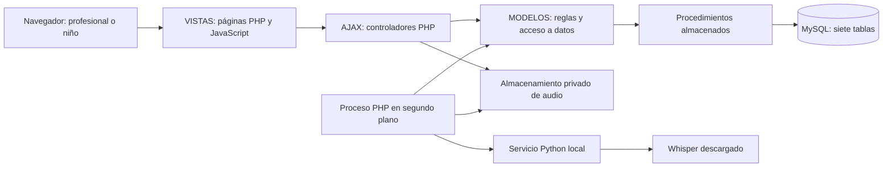

# Plan de construcción del sistema Fluidez

Fecha: 2 de octubre de 2026. Estado: planificación inicial, pendiente de cerrar las decisiones indicadas en la fase 0.

Actualización del 4 de octubre de 2026: entrada directa por `VISTAS/login.html`, conforme al flujo usado en clase. Las páginas posteriores también se ubican en `VISTAS`.

Este documento organiza el desarrollo por módulos y entregas comprobables. No autoriza por sí mismo la ejecución de todas las fases ni cambios en la base. El trabajo de este paso consiste únicamente en guardar el plan.

## 1. Objetivo y alcance

Construir una plataforma web que ayude al profesional a organizar la práctica de lectura y el seguimiento de niños con dificultades lectoras. El profesional registra niños, expedientes, sesiones y ejercicios; el niño practica y envía grabaciones; el sistema produce indicadores automáticos locales que el profesional revisa y acompaña con retroalimentación.

La aplicación apoya la evaluación y el seguimiento. No diagnostica dislexia, no sustituye al profesional y no presenta los errores del reconocimiento de voz como errores comprobados del niño.

### Usuarios

| Actor | Capacidades previstas |
|---|---|
| Profesional | Acceder con contraseña, gestionar niños y expedientes autorizados, crear sesiones y ejercicios, escuchar audios, revisar análisis, confirmar/corregir/descartar resultados y consultar progreso. |
| Niño | Acceder con usuario y PIN de seis dígitos, consultar sus ejercicios, leer, grabar, escuchar antes de enviar, repetir según las reglas aprobadas y recibir mensajes sencillos. |

Los roles y el acceso infantil con PIN proceden del contexto previo y se revisarán al cerrar las reglas funcionales. No se crea un rol administrador ni un registro público de profesionales sin definir primero cómo se habilitan esas cuentas.

### Alcance inicial y posterior

La primera versión funcional termina con el ciclo completo: profesional crea ejercicio → niño envía audio → análisis local → revisión profesional → progreso. La adaptación explicable se añade después de comprobar ese ciclo.

Quedan fuera de esa primera versión: videollamadas, aplicaciones móviles nativas, carga de libros/PDF/EPUB, generación de lecturas con un LLM, diagnósticos automáticos, premios competitivos por velocidad y un catálogo global de ejercicios no aprobado. Una sesión virtual es una modalidad de atención, no una videollamada integrada.

## 2. Fuentes y estado real del proyecto

La prioridad de las fuentes es: decisiones actuales del usuario → PDF y revisión con el ingeniero → estructura SQL corregida → guía anterior como contexto. No copiar instrucciones del proyecto previo que contradigan las decisiones actuales.

| Referencia | Uso |
|---|---|
| `bdd_correcion2_tesis.pdf` y `2 revisión bdd.aac` | Diseño académico de siete tablas y explicación del ingeniero. |
| `BASE_DE_DATOS/bdd_tesis_lectora_corregida.sql` y `BASE_DE_DATOS/LEEME.md` | Estructura MySQL preparada, decisiones de adaptación y comprobaciones efectuadas. |
| `.interface-design/system.md` | Estilo aprobado para el panel profesional. |
| `GUIA_PROMPT_MVC_DESDE_CERO.md` | Requisitos y riesgos del proyecto anterior; su árbol MVC y la octava tabla propuesta no se trasladan automáticamente. |

Situación al crear este plan:

- La creación de `bdd_tesis_lectora_corregida` con siete tablas fue confirmada mediante la captura de Workbench del usuario. No se ha consultado directamente su contenido actual.
- Existen `AJAX/`, `CONFIG/`, `MODELOS/`, `PUBLIC/` y `VISTAS/`, con las subcarpetas acordadas. Todavía no hay sistema PHP implementado.
- No existen procedimientos almacenados del dominio.
- El prototipo y sus capturas fueron eliminados por el usuario. El estilo permanece documentado; no se puede depender de los antiguos `index.html`, `styles.css` o `app.js`.
- IIS está instalado y su servicio se observó activo. Falta verificar/configurar PHP, el alias del proyecto, los permisos y los documentos de inicio.
- Whisper para el sistema todavía debe ser instalado y probado por el usuario. Los recursos temporales empleados para analizar el audio de la revisión no son una instalación del servicio del sistema.
- `tmp/` es material temporal y no pertenece al producto, a sus datos ni a su configuración.

## 3. Arquitectura propuesta

Mantener la organización por capas del ingeniero. PHP web sin framework, páginas PHP renderizadas en el servidor, JavaScript con `fetch` para AJAX, CSS propio y MySQL con procedimientos almacenados. VS Code será el editor; IIS ejecutará PHP. No se necesita Node para servir el sistema final.

Para voz se propone un servicio separado de Python con FastAPI y Faster-Whisper local. FastAPI es una dependencia del servicio de voz, no un cambio al enfoque PHP sin framework. Su elección y versiones se cierran en la fase 0.



Python recibe audio y texto esperado y devuelve un resultado. No recibe credenciales MySQL ni escribe en la base. PHP conserva la autenticación, autorización, almacenamiento, persistencia y reglas de adaptación. El navegador consulta el estado a PHP; no llama directamente al servicio de voz.

### Carpetas y responsabilidades

```text
tesis-fluidez/
├── plan.md
├── AJAX/                       # Controladores por módulo: ?op=operacion
├── CONFIG/                     # Configuración, conexión y controles comunes
├── MODELOS/                    # Modelos, reglas y cliente del servicio de voz
├── PUBLIC/
│   ├── CSS/                    # Estilos comunes y de las pantallas
│   ├── JS/                     # Utilidades comunes; librerías si se necesitan
│   ├── datatables/             # Usar únicamente si un listado lo requiere
│   └── img/                    # Recursos públicos
├── VISTAS/
│   ├── login.html              # Entrada directa desde el navegador
│   ├── inicio.php              # Inicio profesional protegido por sesión
│   ├── actividades.php         # Inicio infantil protegido por sesión
│   ├── plantillas/             # Cabecera, navegación, pie y componentes
│   └── js/                    # Scripts propios de cada vista
├── BASE_DE_DATOS/              # Estructura, SP por módulo y cambios versionados
├── TAREAS/                     # Comandos PHP CLI: worker y tareas de operación
├── SERVICIO_VOZ/               # Código Python y dependencias declaradas
├── PRUEBAS/                    # Casos y evidencias con datos ficticios
└── .interface-design/          # Memoria del estilo aprobado
```

Las carpetas adicionales son propuestas para las fases que las necesitan; este plan no las crea. No se cambia a un árbol `app/Controllers/Repositories` ni se añade un router complejo para reproducir otro proyecto.

| Capa | Responsabilidad y límite |
|---|---|
| `VISTAS` | Mostrar contenido autorizado; no ejecutar SQL ni decidir permisos a partir de botones visibles. |
| `VISTAS/js` | Enviar formularios, actualizar la pantalla y presentar carga/error/éxito. No contener secretos. |
| `AJAX` | Comprobar sesión, método HTTP, CSRF, permisos y datos; llamar al modelo; responder. Lista explícita de operaciones permitidas. |
| `MODELOS` | Implementar casos de uso y reglas; invocar SP con parámetros; gestionar el cliente de voz. Evitar construir `CALL` concatenando entradas del usuario. |
| `CONFIG` | Conexión PDO, configuración, sesión, autorización y utilidades comunes de validación/respuesta. |
| SP/MySQL | Persistencia, integridad y operaciones transaccionales. Las vistas y controladores no deben repartir consultas del dominio. |
| `TAREAS` | Ejecutar trabajo fuera de las peticiones web. Solo accesible desde consola. |
| `SERVICIO_VOZ` | Decodificación, transcripción y cálculos automáticos. Sin reglas de acceso a expedientes ni escritura MySQL. |

Convención de AJAX: lecturas con GET, cambios con POST y respuesta JSON uniforme (`ok`, `mensaje`, `datos`, `errores`), acompañada por un estado HTTP adecuado. Los identificadores del actor proceden de la sesión autenticada, no del formulario. Las llamadas internas no devuelven HTML de error de PHP ni números ambiguos.

### Entrada y navegación como en clase

El usuario abre `http://localhost/tesis-fluidez/VISTAS/login.html`. Su script envía el acceso mediante AJAX al controlador PHP; este valida las credenciales a través del modelo y crea la sesión. Si el acceso es correcto, el script navega a la página del rol dentro de `VISTAS`, por ejemplo `inicio.php` o `actividades.php`. Los nombres de las páginas posteriores son propuestas para la implementación.

Las vistas privadas son PHP y comprueban la sesión y el rol antes de mostrar contenido, incluso si alguien escribe su URL directamente. El login puede conservarse como HTML: los tokens CSRF y el estado de sesión se obtienen de un endpoint PHP del mismo origen. El botón Entrar solo navega después de recibir una autenticación válida.

### IIS, archivos y secretos

- URL de entrada prevista: `http://localhost/tesis-fluidez/VISTAS/login.html`, con alias de IIS hacia la carpeta del proyecto, siguiendo el ejemplo de clase `http://localhost/clases/vistas/login.html`.
- No se exige un `index.php` en la raíz para este flujo. Configurar IIS desde su administrador; si los ajustes se guardan en un `web.config`, documentarlo como configuración del servidor, no como una capa del sistema.
- Usar una configuración de URL base para que enlaces, recursos y AJAX funcionen dentro de `/tesis-fluidez/`.
- PHP NTS mediante FastCGI, con extensiones necesarias: PDO MySQL, cURL y Fileinfo. Verificar versiones compatibles antes de instalarlas. [Manual PHP para IIS](https://www.php.net/manual/en/install.windows.iis.php).
- Bloquear acceso HTTP a `CONFIG`, `MODELOS`, `BASE_DE_DATOS`, `TAREAS`, `SERVICIO_VOZ`, `tmp`, archivos de entorno y documentos internos, incluido este plan. No permitir listado de directorios.
- Audios, modelos descargados, logs y secretos fuera de la carpeta publicada por IIS. Ejemplo de ubicación privada a acordar: `C:\FluidezPrivado\`; no es una carpeta creada todavía.
- Conceder a la identidad de IIS los permisos mínimos. La cuenta MySQL de la aplicación no será `root`; revisar también los privilegios de ejecución/definición de SP.
- El servicio Python escucha únicamente en la interfaz local durante el desarrollo. El token interno se mantiene en el servidor y el worker.

## 4. Base de datos y decisiones pendientes

Se conserva `bdd_tesis_lectora_corregida` como base objetivo. No reconstruirla en cada fase, no volver a importar el script inicial sobre las tablas existentes y no introducir `accesos_expediente` o `asignaciones` como cambios implícitos.

| Tabla | Uso en el sistema |
|---|---|
| `usuarios` | Profesionales y niños; credenciales con hash, perfiles y estado. |
| `historias_clinicas` | Una historia por niño; valoración profesional, dificultades, objetivos y observaciones. |
| `sesiones` | Varias por historia; conserva al profesional que atendió cada sesión. |
| `ejercicios` | Varios por sesión; texto esperado, tipo, nivel, orden, origen y estado. |
| `grabaciones` | Un registro por intento enviado; ruta privada, duración y procesamiento. |
| `analisis_automaticos` | Como máximo uno por grabación; resultado original y detalle JSON. |
| `validaciones_analisis` | Como máximo una por análisis; decisión y correcciones profesionales. |

La relación uno a uno limita duplicados, pero no obliga a que un audio recién enviado tenga ya un análisis ni a que un análisis esté revisado inmediatamente.

### Decisiones que deben cerrarse antes de su módulo

| ID | Decisión | Momento y consecuencia |
|---|---|---|
| D01 | Quién puede ver, registrar y editar cada expediente; cómo se comparte un niño entre profesionales. | Fase 0, antes del CRUD. `ses_id_profesional` registra atención histórica, no una autorización completa. Las siete tablas no guardan responsable actual, concesión o revocación. Definir una política viable con el ingeniero; si exige campos/tablas nuevos, presentarlos como cambio separado. |
| D02 | Alta del primer profesional y de los posteriores; recuperación de contraseña/PIN. | Antes de la fase 2. Propuesta: alta inicial mediante una tarea controlada, sin autorregistro público. Recuperación asistida inicialmente, según permisos acordados. |
| D03 | Estados y reglas de sesión, ejercicio e intento; publicación, pendientes, finalización, cancelación y número máximo de intentos. | Antes de la fase 4. No hay estado de cita/sesión ni estado de finalización por niño en el esquema. Definir qué se deriva de ejercicios/intentos/revisión y qué requeriría una migración. Un envío no equivale por sí solo a ejercicio completado. |
| D04 | Revisor permitido. | Antes de la fase 2 para definir permisos y de la fase 9 para implementarlos. Propuesta inicial: el profesional de la sesión; no hay un revisor independiente registrado en el PDF. No alterar `ses_id_profesional` para cambiar el acceso. |
| D05 | Tamaño, duración y formatos de audio; límites de reintentos y tiempos de proceso. | Antes de la fase 6. Configurar límites comunes a navegador, IIS, PHP y Python; sin imponer ahora cifras arbitrarias. |
| D06 | Criterios de métricas y adaptación, niveles y selección del intento representativo. | Antes de las fases 8, 10 y 11. Requiere criterio del profesional; no convertir reglas técnicas en normas clínicas. |
| D07 | Uso y conservación de datos y audios de menores; autorización del representante y procedimiento de retirada. | Antes de cualquier prueba con menores. Empezar con datos ficticios y voces adultas autorizadas. Acordar dónde se documentará esto; el esquema actual no almacena consentimiento. |
| D08 | Versiones, equipo, instalación de Whisper, inicio de procesos y entorno final de demostración. | Fase 0 y prueba temprana de voz. No depender de GPU ni de Internet durante el análisis sin comprobarlo. |

El plan puede avanzar en entorno, interfaz común y pruebas ficticias mientras se resuelven decisiones independientes. No implementar una política de acceso indefinida ni bloquear todas las fases por una decisión de adaptación que se necesita más tarde.

### Reglas técnicas con el esquema actual

- Proporcionar fechas y estados expresamente: el SQL preparado no incluye valores predeterminados ni actualización automática de fechas.
- Validar roles, estados, rangos y textos en el servidor/SP: el esquema mantiene VARCHAR e INT sin todas esas reglas de negocio.
- Registrar niño e historia en una transacción. Las operaciones que cambian varios registros deben confirmar todo o revertir todo.
- Numerar sesiones, ejercicios e intentos dentro de transacciones con bloqueo del registro padre. No usar `MAX + 1` sin protección concurrente; el esquema no declara únicas esas combinaciones.
- Una vez que un ejercicio tenga grabaciones, conservar el texto contra el que se analizó. Propuesta: impedir editar el contenido y crear un ejercicio nuevo para el cambio.
- Desactivar/archivar según estados acordados; las claves foráneas `RESTRICT` impiden borrar padres con dependientes. No añadir borrado en cascada como atajo.
- Versionar los SP por módulo y los cambios aprobados en `BASE_DE_DATOS`. Respaldar antes de modificar una base con información.

## 5. Fases y entregas

Cada fase incluye pantalla, controlador, modelo, SP y comprobaciones que correspondan. No desarrollar todos los SP ni todas las pantallas por adelantado. Registrar en este plan qué se implementó y qué prueba se ejecutó realmente.

| Fase | Resultado visible | Depende de |
|---|---|---|
| 0 | Entorno y reglas iniciales documentados | Este plan |
| 1 | Página de inicio en IIS y estructura común | 0 |
| 2 | Acceso seguro por rol y política de permisos | 1, D01/D02/D04 |
| 3 | Registro y expediente de un niño | 2 |
| 4 | Sesión con ejercicios reales | 3, D03 |
| 5 | Niño lee, graba y escucha localmente | 2 y 4 |
| 6 | Audio privado registrado y procesamiento simulado | 5, D05 |
| 7 | Whisper local integrado mediante proceso independiente | 6 y prueba temprana de voz |
| 8 | Análisis automático explicable | 7, D06 |
| 9 | Revisión profesional y retroalimentación | 8 |
| 10 | Panel y progreso con información real | 9 |
| 11 | Recomendaciones adaptativas por reglas | 10, D06 |
| 12 | Evaluación, instalación reproducible y documentación de tesis | Primera versión integrada; 11 si la adaptación forma parte de la entrega |

### Fase 0 — Preparación y decisiones iniciales

**Trabajo:** comprobar IIS/PHP/MySQL/Python, definir URL y ubicación privada, inventariar versiones y capacidad del equipo, acordar D01/D02/D04 y registrar los demás pendientes. Verificar el esquema importado sin recrearlo. Iniciar control de versiones y excluir credenciales, audios, modelos, temporales y datos reales.

**Entrega:** ficha del entorno, política de acceso escrita y lista priorizada de decisiones. Copia de respaldo del esquema al comenzar cambios.

**Cierre:** se conoce quién realizará cada acción, qué base se usará y cómo se ejecutará PHP. Si D01 exige cambiar el esquema, diseñar y aprobar ese cambio antes de continuar con expedientes.

**Prueba temprana independiente de Whisper:** el usuario instala el entorno Python, motor y modelo; comprobar transcripción de una voz adulta en español, carga desde ruta local y funcionamiento sin conexión tras descargar el modelo. Medir tiempo/RAM y probar una lectura con pausas y pseudopalabras. Esto puede avanzar mientras se construyen las fases 1–4. Si el reconocimiento de pseudopalabras no resulta fiable, prever revisión manual para ese tipo de ejercicio.

### Fase 1 — Base PHP por capas y estilo compartido

**Trabajo:** página `VISTAS/login.html`, configuración de IIS desde su administrador, conexión PDO, helper para SP, manejo de errores y respuesta JSON; plantillas PHP y utilidades AJAX. Rehacer los componentes comunes desde `.interface-design/system.md`: fondo claro, tarjetas, navegación, botones, formularios, foco y ventanas. No recuperar dependencias ni pantallas ficticias borradas como si aún existieran.

**Entrega:** página de entrada desde `localhost/tesis-fluidez/VISTAS/login.html`, plantilla profesional y comprobación interna de conexión. Los secretos no aparecen en la respuesta.

**Cierre:** recursos funcionan bajo el alias, JSON válido, errores internos controlados y acceso directo a carpetas privadas bloqueado. Revisar controles claros en Brave y Chrome, escritorio y móvil. No incorporar métricas de ejemplo como resultados reales.

### Fase 2 — Autenticación, cuentas y autorización

**Trabajo:** acceso profesional con contraseña y niño con PIN; creación controlada de cuentas profesionales; cierre de sesión y controles compartidos de acceso. Hash/verificación de credenciales, regeneración de sesión, CSRF, escape HTML, validación y límites de intentos de acceso persistentes que no se reinicien cambiando una cookie. El mecanismo concreto se elige en fase 0.

**SP previstos:** `sp_obtener_usuario_login`, `sp_crear_profesional`, `sp_actualizar_credencial_usuario`, según la política de alta. La verificación del hash se hace en PHP; no mandar la contraseña como texto a un SP de comparación.

**Entrega:** desde el login se navega a otra página de `VISTAS` correspondiente al rol, después de autenticar correctamente. Las páginas privadas y los controladores AJAX comprueban sesión y permisos. Datos del actor siempre obtenidos de la sesión.

**Cierre:** credencial correcta/incorrecta, usuario inactivo, PIN inválido, cierre, CSRF y manipulación de IDs. Probar profesional A frente a B y niño A frente a B según D01. No basta con ocultar enlaces.

### Fase 3 — Niños e historias clínicas

**Trabajo:** listado, búsqueda, registro de niño e historia, ficha y edición autorizada de datos clínicos. El profesional establece dificultades, objetivos y diagnóstico si corresponde; el sistema no lo genera. PIN inicial y restablecimiento según D02.

**SP previstos:** `sp_registrar_nino_con_historia`, `sp_listar_ninos`, `sp_obtener_nino_historia`, `sp_actualizar_nino`, `sp_actualizar_historia`.

**Entrega:** niño ficticio registrado con exactamente una historia y ficha persistente.

**Cierre:** rollback si falla el expediente, nombre de usuario duplicado, historia duplicada, campos inválidos y acceso no autorizado. Confirmar actualización explícita de `his_fecha_actualizacion`.

### Fase 4 — Sesiones y ejercicios

**Trabajo:** crear/consultar sesiones, conservar su profesional, registrar observaciones e indicaciones; ejercicios de palabras, pseudopalabras, oraciones y texto breve, con contenido e instrucciones propios. Ordenar ejercicios, controlar edición tras grabaciones y establecer publicación/pendientes según D03.

**SP previstos:** `sp_crear_sesion`, `sp_listar_sesiones_historia`, `sp_obtener_sesion`, `sp_actualizar_sesion`, `sp_crear_ejercicio`, `sp_listar_ejercicios_sesion`, `sp_actualizar_ejercicio`.

**Entrega:** sesión de un niño con al menos dos ejercicios utilizables. La lista por fecha utiliza datos reales. Un calendario de citas con cancelación no se presenta como implementado si falta su estado en la base.

**Cierre:** dos sesiones atendidas por profesionales distintos, numeración concurrente sin duplicados, orden válido y permisos. No permitir referenciar un usuario de rol niño como profesional de sesión.

### Fase 5 — Práctica infantil y grabación en el navegador

**Trabajo:** diseñar una pantalla infantil propia, con texto legible y pocas acciones; listar actividades, mostrar lectura/instrucciones y grabar/escuchar/repetir localmente. No copiar la densidad del dashboard profesional.

**SP previstos:** `sp_listar_ejercicios_nino`, `sp_obtener_ejercicio_nino`, conforme a D03.

**Entrega:** el niño ficticio abre su actividad, graba voz adulta de prueba y la escucha. Todavía no depende de Whisper.

**Cierre:** micrófono permitido/denegado/ausente, grabación vacía, interrupción y salida de pantalla; liberar el micrófono y evitar envíos accidentales. Seleccionar MIME soportado mediante `MediaRecorder.isTypeSupported`. El micrófono necesita contexto seguro: localhost sirve para desarrollo; acceso desde otro equipo requerirá HTTPS. [getUserMedia](https://developer.mozilla.org/en-US/docs/Web/API/MediaDevices/getUserMedia), [formatos de MediaRecorder](https://developer.mozilla.org/en-US/docs/Web/API/MediaRecorder/isTypeSupported_static).

### Fase 6 — Subida, reproducción privada y estados

**Trabajo:** recepción multipart en PHP, límites y validación del archivo real, nombre generado por servidor, almacenamiento privado, registro transaccional del intento y reproducción autorizada mediante controlador. Compensar la operación: eliminar archivo si falla el registro o resolver registros/archivos inconsistentes. Las rutas no las suministra el navegador.

**SP previstos:** `sp_registrar_grabacion`, `sp_obtener_grabacion_autorizada`, `sp_listar_grabaciones_ejercicio`, `sp_obtener_estado_grabacion`, `sp_reclamar_grabacion_pendiente`.

**Entrega:** un intento guardado como `pendiente`, reproducible solo por actores autorizados. El niño ve un estado de espera. Una simulación controlada comprueba la interfaz de procesamiento antes del motor real.

**Cierre:** formato no permitido, archivo que solo cambia su extensión, tamaño/duración excesivos, doble clic, dos envíos simultáneos, archivo ausente y reproducción por ID ajeno. No mostrar una URL directa del almacenamiento privado. Reintentar el envío no debe duplicarlo: diseñar una clave de envío y su registro seguro antes de implementarlo.

### Fase 7 — Servicio local y procesamiento fuera de la petición web

**Trabajo:** integrar Python/FastAPI, el modelo instalado por el usuario y un worker PHP CLI. Mantener el modelo cargado en el servicio. PHP web registra el audio y responde; no espera durante toda la transcripción. El navegador consulta estado con intervalos acotados y detiene la consulta al terminar o salir.

**SP previstos:** reclamar trabajo, guardar resultado, registrar fallo y reintento autorizado. Se implementan antes de conectar el motor.

**Entrega:** una grabación pasa por `pendiente → procesando → completado` o `fallido`; resultado persistido por PHP. Modelo local, audio procesado localmente y sin clave de API de transcripción.

**Cierre:** servicio apagado, modelo ausente, timeout, respuesta inválida, reinicio del worker y doble proceso. Verificar que el navegador no recibe el token y que Python no conecta a MySQL.

### Fase 8 — Indicadores automáticos y trazabilidad

**Trabajo:** separar reconocimiento de evaluación: normalizar/tokenizar de forma documentada, alinear texto esperado y reconocido, identificar diferencias y calcular indicadores. Guardar segmentos/palabras con tiempos y versión del modelo/algoritmo dentro de `ana_detalle_errores`, sin nuevos campos implícitos.

**Entrega:** transcripción, duración, PCPM y diferencias estimadas, con detalle suficiente para revisar por qué se obtuvo cada valor. Valores no calculables permanecen NULL y se muestran como no disponibles.

**Cierre:** lecturas de prueba con sustitución, omisión, inserción, repetición, silencio y ruido; comparación con transcripción manual. Duración cero/sin voz no produce división por cero ni un resultado inventado. Pseudopalabras se evalúan por separado y requieren revisión manual mientras la prueba no justifique métricas automáticas fiables.

### Fase 9 — Revisión y retroalimentación profesional

**Trabajo:** cola de análisis sin validación, audio y comparación; confirmar, corregir o descartar; observaciones y mensaje al niño. Conservar intacto el análisis automático. El revisor se identifica a través de la sesión según D04, sin añadir automáticamente `val_id_profesional`.

**SP previstos:** `sp_listar_analisis_por_revisar`, `sp_obtener_detalle_analisis`, `sp_guardar_validacion`, `sp_obtener_retroalimentacion_nino`.

**Entrega:** una validación persistente y un mensaje apropiado para el niño.

**Cierre:** análisis pendiente/fallido no validable como completo, confirmación/corrección/descarte, doble revisión concurrente y profesional no autorizado. El PDF solo admite una validación por análisis: definir si se puede editar y cómo se conserva evidencia antes de permitir revalidaciones históricas.

### Fase 10 — Progreso y panel profesional

**Trabajo:** integrar lista por fecha, niños, sesiones y revisiones en el estilo aprobado. Mostrar historial y gráficos por niño, tipo de ejercicio, nivel y período, diferenciando automático y validado. No añadir indicadores que el esquema o los datos no permitan obtener.

**SP previstos:** `sp_obtener_resumen_profesional`, `sp_obtener_progreso_nino`, `sp_listar_historial_intentos`.

**Entrega:** panel con datos reales, revisión desde el panel y seguimiento del niño.

**Cierre:** períodos vacíos, sin validación, correcciones y descartes. Mostrar todos los intentos en el historial; para la curva principal se propone un intento validado representativo por ejercicio, con regla explícita. No contar todos los reintentos como sesiones independientes ni mezclar textos de dificultad distinta como si fueran equivalentes.

### Fase 11 — Adaptación mediante reglas explicables

**Trabajo:** reglas acordadas con el profesional, alimentadas preferentemente por resultados validados; sugerir mantener nivel o modificar dificultad/contenido. Registrar origen `adaptativo`, recomendación y criterio en los campos existentes de `ejercicios`. El profesional aprueba la propuesta antes de publicarla, según D03.

**SP previstos:** `sp_obtener_base_recomendacion`, `sp_crear_ejercicio_adaptativo`, aprovechando los SP de publicación aprobados.

**Entrega:** recomendación trazable que explica qué resultado/regla la produjo.

**Cierre:** resultado descartado, métricas ausentes, varias reglas aplicables, límite de recomendaciones, persistencia y aprobación profesional. No escalar dificultad solo por velocidad ni crear una cadena infinita de ejercicios.

### Fase 12 — Evaluación, operación y entrega de tesis

**Trabajo:** prueba completa desde cero, accesibilidad, compatibilidad, permisos, evaluación del reconocimiento y restauración de respaldo. Documentar instalación, SP, servicio, worker, límites, arranque y recuperación. Preparar manuales profesional/niño, arquitectura y evidencias para la tesis.

**Entrega:** versión reproducible y dossier de pruebas con limitaciones observadas.

**Cierre:** profesional crea niño/sesión/ejercicio → niño envía → Whisper analiza → profesional revisa → progreso actualiza; servicio caído y recuperación; prueba en Brave/Chrome y móvil; restauración conjunta de SQL y audios. Las pruebas con menores solo se realizan después de resolver D07 y con supervisión adecuada.

## 6. Contrato y operación de Whisper local

### Elección y responsabilidades

Se propone Faster-Whisper como implementación local de Whisper, español, CPU/int8 y modelo `small` como punto de partida. No es una exigencia definitiva de hardware ni una promesa de precisión: la prueba temprana decidirá tamaño/configuración. Admite ejecución CPU/int8 y marcas por palabra. [Documentación de Faster-Whisper](https://github.com/SYSTRAN/faster-whisper).

| Responsable | Tarea |
|---|---|
| Usuario | Instalar Python compatible, entorno virtual, dependencias y modelo; indicar ruta local y comprobar la prueba inicial con ayuda cuando la solicite. |
| Desarrollo PHP | Guardar audios, autorizar acciones, registrar/reclamar intentos, llamar al servicio y guardar resultados. |
| Desarrollo Python | Servicio, decodificación, transcripción, tiempos y análisis técnico; contrato validado. |
| Profesional | Criterios de lectura, revisión del resultado y validación de reglas/umbrales. |

Fijar versiones reproducibles de Python, Faster-Whisper, CTranslate2, PyAV y FastAPI tras probarlas juntas. No reutilizar a ciegas la combinación temporal empleada para transcribir la revisión: hubo una incompatibilidad de API de audio. Probar la carga de un archivo antes de integrar el navegador. Los formatos recibidos deben poder decodificarse; añadir conversión si hace falta y documentar su herramienta.

### Contrato propuesto

- `GET /internal/v1/health`: estado del servicio y del modelo, sin datos personales.
- `POST /internal/v1/analyses`: audio multipart y metadatos mínimos: identificador técnico de solicitud, texto esperado y tipo de ejercicio. Token interno en cabecera; límites y timeout.
- Respuesta versionada: identificador de solicitud, estado, duración, transcripción, segmentos/palabras con tiempos, métricas disponibles, alineación, advertencias, modelo y versión del algoritmo. Nada de nombres, historia clínica, PIN ni credenciales MySQL.
- PHP valida tipos, rangos, identificador y versión antes de persistir. Un JSON malformado o una respuesta parcial no se convierte en `completado`.

### Worker y consistencia

Propuesta para la primera instalación local: un único worker PHP CLI, supervisado con un mecanismo de inicio de Windows a concretar. Usar un bloqueo exclusivo de MySQL mantenido por la conexión del worker para impedir un segundo worker, además de reclamar el registro pendiente transaccionalmente. Liberar el bloqueo al terminar; una caída de la conexión debe detener ese worker.

`grabaciones` aporta el estado de trabajo, pero no contiene propietario de bloqueo, contador de reintentos ni vencimiento. No prometer una cola distribuida con recuperación automática basada en campos inexistentes. Para esta primera versión, recuperar trabajos atascados de forma controlada después de asegurar que el worker anterior terminó, con diagnóstico técnico privado. Si se necesita ejecución paralela o recuperación automática, diseñar la persistencia adicional como cambio aprobado.

Guardar análisis y marcar grabación como completada en una misma transacción. Si hay fallo, no borrar el audio ni la validación previa; un reintento autorizado reutiliza el intento y no sobrescribe un análisis completado o revisado. Usar la clave única de `ana_id_grabacion` para impedir dos resultados. Distinguir fallos recuperables de formato/audio inválido y evitar reintentos infinitos.

## 7. Criterios del análisis y de progreso

Whisper transcribe; no determina por sí solo si el niño leyó correctamente. La alineación calcula diferencias entre el texto esperado y una transcripción que también puede equivocarse. Presentarlas como estimaciones hasta la revisión.

- Propuesta PCPM: `palabras correctas estimadas × 60 / duración en segundos`. El profesional debe aprobar qué intervalo cuenta como lectura. No variar esa definición entre intentos sin guardar versión.
- La duración se obtiene del audio decodificado, no del temporizador del navegador. Registrar el criterio de inicio/final y el manejo de silencios.
- Pausas: umbral inicial para evaluar, no norma clínica. Conservar los tiempos respecto al audio original; VAD o recorte no deben eliminar las pausas que se pretende medir. Comparar tiempos automáticos con escucha manual.
- Documentar normalización de mayúsculas, puntuación, tildes, números y tokenización. No ocultar sustituciones relevantes ni sumar una misma repetición como inserción y repetición a la vez.
- La corrección de PCPM se guarda en `val_palabras_correctas_minuto_corregidas`; la transcripción corregida en `val_transcripcion_corregida`. Los campos de conteo de errores corregidos no existen: no etiquetar como validados todos los conteos automáticos solo porque se corrigió PCPM. Si se necesitan conteos corregidos persistentes, presentar esa ampliación antes de implementarla.
- Para progreso, usar resultados confirmados o valores profesionales corregidos; excluir descartados de la curva validada y mantenerlos en el historial. No inventar cero cuando una métrica corregida esté ausente.
- Conservar tipo, nivel, contenido, intento, fechas y criterio de selección. La comparación entre lecturas exige dificultad y condiciones comparables; no declarar mejora clínica por una gráfica ascendente.

## 8. Verificación y definición de terminado

En cada módulo: formulario/pantalla funcional, respuesta AJAX estable, validación de servidor, permisos comprobados, SP instalados de forma versionada, persistencia correcta y estados de vacío/carga/error/éxito. Debe poder explicarse el recorrido de una petición entre capas.

Priorizar pruebas que comprueban riesgos reales: acceso a recursos ajenos, rollback, concurrencia al numerar/enviar/revisar, audio privado, fallo del servicio, idempotencia y diferencia entre automático/validado. No crear pruebas que solo repiten el código.

La evaluación de voz utiliza referencias transcritas manualmente y reporta resultados por tipo de ejercicio, incluyendo pseudopalabras, ruido, pausas y silencio. Medir errores de transcripción, coincidencia del análisis con revisión manual, tiempo de procesamiento y consumo en el equipo utilizado. No prometer eficacia clínica a partir de una demostración.

Guardar evidencias con datos ficticios o autorizados, sin publicar audios de menores en el repositorio ni logs. Una entrega completa incluye instrucciones para iniciar IIS/MySQL, servicio y worker, diagnosticar fallos y restaurar base y archivos privados de manera coherente.

## 9. Seguimiento del trabajo

No se asignan fechas de entrega antes de conocer disponibilidad, equipo y decisiones pendientes. El orden de fases y sus criterios permiten medir avance sin confundir archivos creados con funciones terminadas.

- [x] Estilo profesional documentado.
- [x] SQL de siete tablas preparado y verificado por separado.
- [x] Creación de la base corregida confirmada por el usuario en Workbench.
- [x] Carpetas principales por capas creadas.
- [x] Plan inicial guardado.
- [ ] Fase 0: decisiones y entorno.
- [ ] Prueba temprana de Whisper instalada por el usuario.
- [ ] Fase 1: base PHP e interfaz común.
- [ ] Fase 2: autenticación y autorización.
- [ ] Fase 3: niños e historias.
- [ ] Fase 4: sesiones y ejercicios.
- [ ] Fase 5: práctica infantil.
- [ ] Fase 6: audios privados y estados.
- [ ] Fase 7: servicio y worker integrados.
- [ ] Fase 8: indicadores automáticos.
- [ ] Fase 9: revisión y feedback.
- [ ] Fase 10: panel y progreso.
- [ ] Fase 11: adaptación.
- [ ] Fase 12: evaluación y entrega.

El siguiente incremento será la fase 0. Su propósito es dejar claras las reglas de acceso y verificar el entorno para entrar desde `localhost/tesis-fluidez/VISTAS/login.html` y ejecutar las páginas PHP posteriores; no comenzar todos los módulos simultáneamente.
